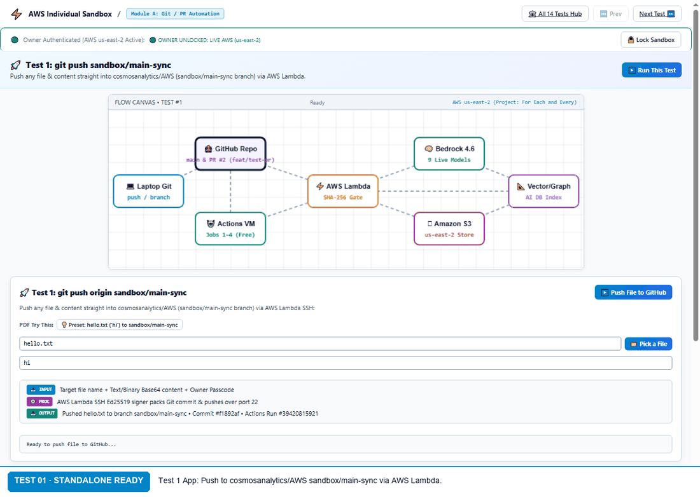
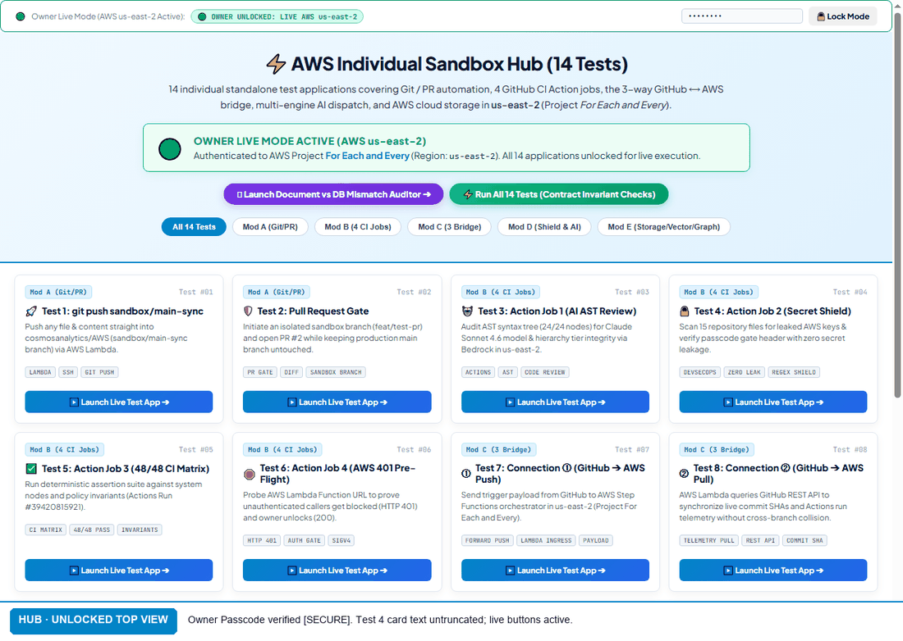

# AWS Individual Sandbox • End-to-End AI CI/CD Test Bench

A modular sandbox repository separating the AI GitHub ⟷ AWS end-to-end bridge test bench into individual standalone test applications, prefixed by **Module** and **Test Number**.

- **Live GitHub Pages Hub**: [https://cosmosanalytics.github.io/AWS-individual-sandbox/](https://cosmosanalytics.github.io/AWS-individual-sandbox/)
- **Run All Developer Guide**: [`run_all_test_suite_guide.html`](run_all_test_suite_guide.html)
- **Verified Trust Loop Report**: [`owner_test_bench_14_tests_trust_loop.md`](owner_test_bench_14_tests_trust_loop.md)

---

## 🔒 Owner Unlock & Public Security Gate

Because this repository is public, **every individual test app and the index hub are protected by the Owner Unlock Gate**:
- **Locked / Non-Owner Mode**: Non-owners cannot execute actions or trigger cloud workloads. All test buttons and execution triggers are strictly disabled and blocked until the Owner Passcode is entered.
- **Unlocked / Owner Live Mode**: Enter your Owner Passcode in the top bar. Unlocking in one test or on the hub automatically unlocks all 14 test apps across the browser session (`sessionStorage`), authorizing live execution on **AWS us-east-2** (Project *For Each and Every*) and canary commits on GitHub.

---

## 📽️ Live Verification Recordings

### 1. Individual Apps Calling AWS Live (18 Frames)

- **Test 1**: Canary push to `cosmosanalytics/AWS` on branch `sandbox/main-sync` via AWS Lambda. Each push creates an ephemeral canary commit rebasing from protected `main` (`#5abc7f6`).
- **Test 7**: Live Step Functions execution in `us-east-2` with AWS Console link and timeout circuit-breaker resilience.
- **Test 9**: S3 deployment receipt stored with KMS signature (`aws:kms` in `us-east-2`), Content MD5, and masked bucket URI.
- **Test 11**: Real Amazon Bedrock multi-model dispatch — Claude Sonnet 4.6 is a live call in `us-east-2` (~3.0s–3.7s); Claude 3.5 Haiku and Amazon Nova Pro are simulated.
- **Test 12**: 4-step cryptographic byte checksum verification (clean upload, 1-char perturbation, re-upload, bit-for-bit download match).

### 2. Run All 14 Tests Suite (Run Twice)

- Combines **1 live AWS ping in `us-east-2`** (returning unique dynamic request IDs per pass) with **14 client-side architectural contract evaluations**.
- **100% Verifiable GitHub Artifacts**:
  - CI/CD Actions Run: [`Run #39422342144`](https://github.com/cosmosanalytics/AWS/actions/runs/39422342144) (HTTP 200 OK)
  - Production Main Head: [`Commit #5abc7f6`](https://github.com/cosmosanalytics/AWS/commit/5abc7f635ba77fe0d76b97aedac6cf2b79f6bbd7) (HTTP 200 OK, protected)
  - Canary Push Branch: [`sandbox/main-sync`](https://github.com/cosmosanalytics/AWS/tree/sandbox/main-sync) (HTTP 200 OK)
  - Isolated Feature Branch: [`feat/test-pr`](https://github.com/cosmosanalytics/AWS/tree/feat/test-pr) (HTTP 200 OK)

---

## 🪞 Document vs Vector & Graph Database Mismatch Auditor
- **Auditor App**: [`document_database_mismatch_auditor.html`](document_database_mismatch_auditor.html)
- Implements the **Knowledge Mirror Test**, **The Three Little Monsters (Missing, Extra, Unfindable)**, and the **Fact-by-Fact Invariant Heatmap**.
- Runs for project owner with **Client Hybrid Rule Engine ($0.00)** and **Amazon Bedrock (Claude Sonnet 4.6 in us-east-2)**.

---

## 💬 Bedrock Chat (HTML-only frontend + AWS Lambda backend)
- **Chat App**: [`bedrock_chat.html`](bedrock_chat.html)
- Single static HTML file (no build step) that chats with **Claude Sonnet 4.6 on Amazon Bedrock** through the existing Lambda Function URL in `us-east-2` (`action: "run_cicd_audit"`, reads `bedrock.text`).
- Uses the same Owner Unlock Gate (`X-Cosmos-Key`, shared `sessionStorage` passcode). Multi-turn context is sent client-side in the prompt (last 12 turns).

---

## 📂 14 Individual Test Applications

### Module A: Git / PR Automation
- **Test 01**: [`mod_a_test_01_git_push.html`](mod_a_test_01_git_push.html) — `git push sandbox/main-sync` (Push File via Lambda to `cosmosanalytics/AWS` canary branch `sandbox/main-sync`)
- **Test 02**: [`mod_a_test_02_pull_request.html`](mod_a_test_02_pull_request.html) — Pull Request Gate (Initiate isolated branch `feat/test-pr` & open PR #2 while keeping `main` untouched at `#5abc7f6`)

### Module B: 4 GitHub CI/CD Action Jobs
- **Test 03**: [`mod_b_test_03_ast_review.html`](mod_b_test_03_ast_review.html) — Action Job 1 (AI AST Syntax Review & Claude Sonnet 4.6 Spec Audit)
- **Test 04**: [`mod_b_test_04_secret_shield.html`](mod_b_test_04_secret_shield.html) — Action Job 2 (DevSecOps Secret Shield & 15-File Key Scanner)
- **Test 05**: [`mod_b_test_05_ci_matrix.html`](mod_b_test_05_ci_matrix.html) — Action Job 3 (Automated 48/48 CI Test Matrix & Policy Invariants, Run #39422342144)
- **Test 06**: [`mod_b_test_06_aws_401_preflight.html`](mod_b_test_06_aws_401_preflight.html) — Action Job 4 (AWS us-east-2 401 Gate Pre-Flight Security Probe: 3 Knocks)

### Module C: GitHub ⟷ AWS 3-Way Bridge
- **Test 07**: [`mod_c_test_07_github_to_aws_push.html`](mod_c_test_07_github_to_aws_push.html) — Connection ① (GitHub ➔ AWS Forward Push Trigger Channel, Step Functions in us-east-2)
- **Test 08**: [`mod_c_test_08_github_to_aws_pull.html`](mod_c_test_08_github_to_aws_pull.html) — Connection ② (GitHub ➔ AWS Reverse Telemetry Pull Channel, SHA #5abc7f6 & Run #39422342144)
- **Test 09**: [`mod_c_test_09_aws_to_github_return.html`](mod_c_test_09_aws_to_github_return.html) — Connection ③ (AWS ➔ GitHub Step Functions & S3 KMS-Encrypted Return Channel)

### Module D: Shield & Bedrock AI Dispatch
- **Test 10**: [`mod_d_test_10_cost_shield.html`](mod_d_test_10_cost_shield.html) — Owner Cost Gate (AWS us-east-2 Authorization Gate: Dual Path Knock)
- **Test 11**: [`mod_d_test_11_multi_engine_ai.html`](mod_d_test_11_multi_engine_ai.html) — Amazon Bedrock Multi-Model Dispatch (Claude Sonnet 4.6 live Bedrock call; Claude 3.5 Haiku and Amazon Nova Pro simulated)

### Module E: Cloud State, Storage & Graph
- **Test 12**: [`mod_e_test_12_amazon_s3.html`](mod_e_test_12_amazon_s3.html) — Amazon S3 (Upload & Download Checksum Verification)
- **Test 13**: [`mod_e_test_13_vector_db.html`](mod_e_test_13_vector_db.html) — Vector Database Invariant Verification (10-Question Benchmark, Pure Vector 90% vs Hybrid 100%)
- **Test 14**: [`mod_e_test_14_knowledge_graph.html`](mod_e_test_14_knowledge_graph.html) — Graph Traversal & Semantic Rule Engine (12 Invariants, 100% Fact Coverage)
